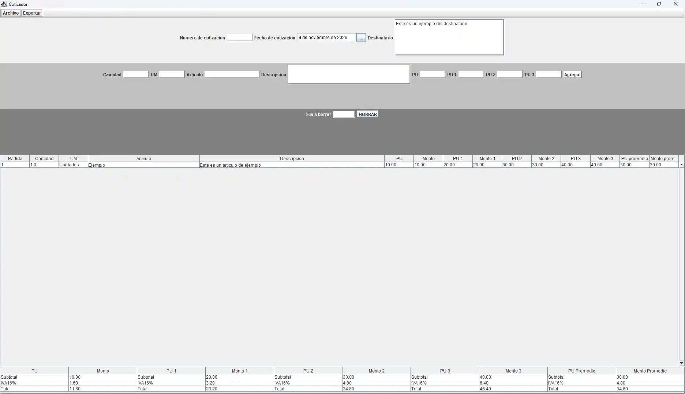
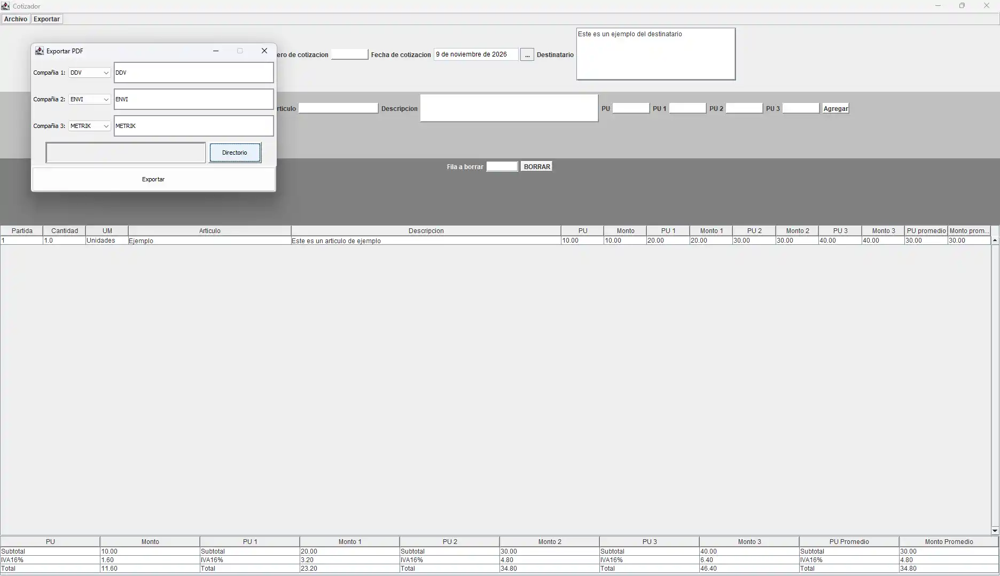
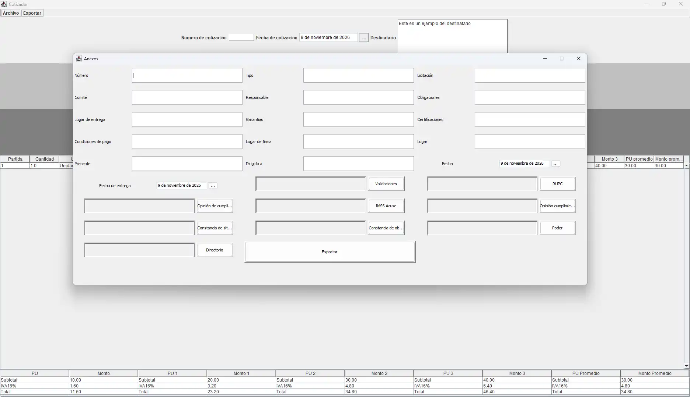
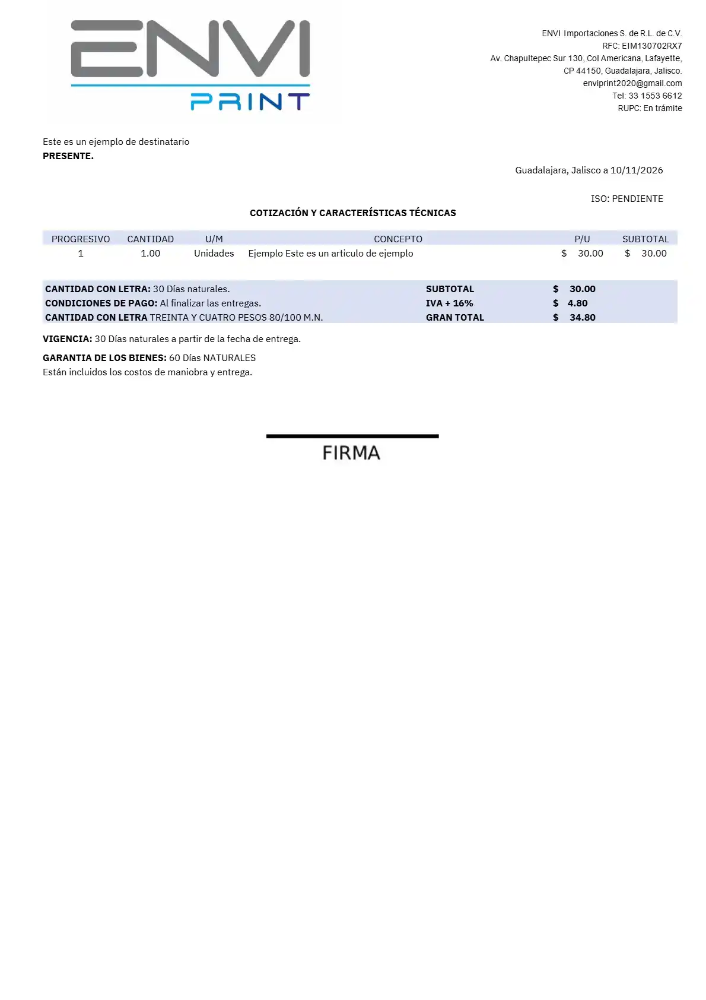
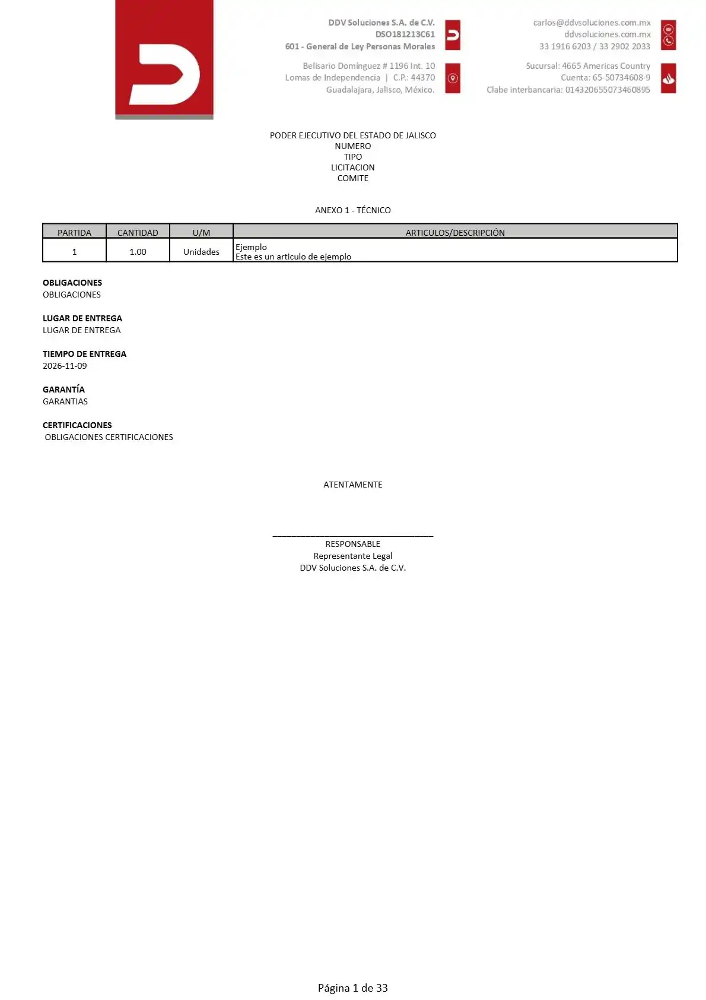

# > Generador de Cotizaciones de Escritorio
Aplicación de escritorio robusta y eficiente desarrollada en Java, diseñada para optimizar y automatizar el flujo de creación de cotizaciones comerciales.
El sistema combina una interfaz intuitiva con potentes capacidades de procesamiento de documentos en PDF, permitiendo a los usuarios gestionar desde cálculos dinámicos, distintos archivos de cotización y cotizaciones complejas con archivos adjuntos.

## > Stack Tecnológico
* Lenguaje: Java
* Interfaz Gráfica: Swing
* Generación de Documentos: LibrePDF
## > Características Principales
* ## > Gestión dinámica de productos
    * **Gestión dinámica de productos:** Permite al usuario ingresar los datos de los productos a cotizar de forma fluida.
    * **Actualización instantánea:** El subtotal, los impuestos y el total general se calculan y se reflejan de manera automática conforme se van añadiendo o modificando los elementos en la cotización.
* ## > Motor de Generación de PDFs Personalizados
    * **Variedad de formatos:** Ofrece múltiples plantillas de diseño pre construidas para elegir la cotización con la empresa que mejor se adapte al requerimiento del cliente.
    * **Diseño estructurado:** Cada formato cuenta con características únicas en disposición, tipografía, paleta de colores e iconografía.
    * **Componentes estáticos y dinámicos:** Incorpora elementos fijos profesionales (como encabezados y pies de página corporativos en cada hoja) junto con la sección dinámica que detalla los productos y datos financieros de la cotización.
* ## >Cotización Formal y Anexos
    * **Campos extendidos:** Soporte para generar cotizaciones formales que solicitan información y campos adicionales, los cuales se distribuyen y muestran de manera coherente a lo largo de todo el documento.
    * **Unión automatizada de anexos:** Capacidad para incluir documentos adicionales que se integran y fusionan automáticamente en un solo archivo PDF final, facilitando el envío de documentación complementaria.
* ## > Sistema de Respaldo y Portabilidad de Datos
    * **Gestión basada en archivos:** Implementa un sistema seguro de guardado y cargado de datos local.
    * **Intercambio seguro:** Permite respaldar la información o transferirla fácilmente a terceros mediante archivos estructurados que pueden ser leídos y abiertos por cualquier otro usuario que cuente con la aplicación.

## Galería del proyecto
### Menú de inicio de la aplicación
En este menú podemos manejar los datos comunes de la cotización como:

* Fecha
* Número/Título
* Destinatario

Así como los artículos junto a sus propiedades.
 
Además, desde este menú podemos acceder a los otros menús:
* Archivo (Guardar, Abrir, Cerrar, Nuevo...)
* Exportar (Cotización básica y compleja)

Además de poder previsualizar el subtotal, impuesto y total de todos los artículos.

### Menú de exportación documento básico
En este menú podemos exportar las cotizaciones básicas, eligiendo el formato y lugar en el que se guardaran los documentos.

### Menú de exportación documento complejo
En este menú se realiza la exportación de cotizaciones complejas, conteniendo campos adicionales de información, como el tipo, presente, condiciones de pago etc.

En este menú también podemos agregar formatos necesarios para realizar este tipo de cotización, siendo algunos de estos las validaciones, RUPC, constancias fiscales entre otros.

### Documento básico
Un documento básico usando uno de los formatos preestablecidos, cada uno con sus propias imágenes, fuentes, colores e iconografías; y mostrando los productos correspondientes de la cotización.

### Documento complejo
Un documento complejo, contando con los campos adicionales introducidos durante la exportación.
Este documento es más largo al consistir de múltiples anexos, algunos generados con la información y otros incluidos de manera externa uniendo los demás documentos agregados.
Adicionalmente, este documento cuenta con funciones adicionales, como unión de documentos, paginación y muestra de la cantidad de páginas en secciones del documento, así como funciones generales como pie, encabezado, imágenes entre otros.

*Las imágenes y documentos necesarios para renderizar correctamente los formatos fueron eliminados por seguridad.*